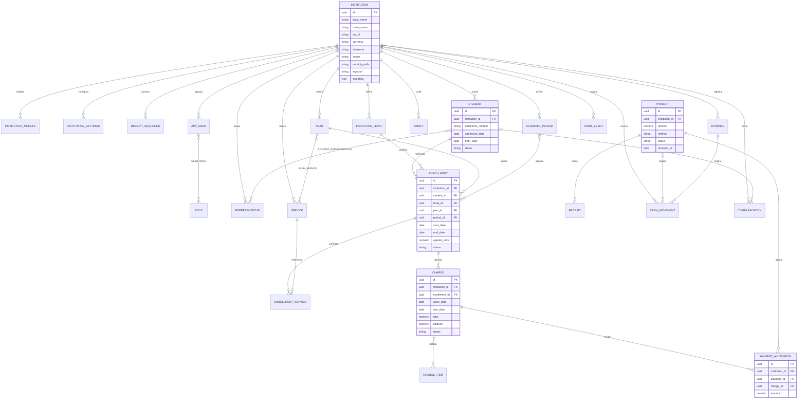

# Fase 0 — Análisis del repositorio y propuesta de arquitectura

**Proyecto:** Akira Educación — plataforma modular de gestión escolar multiinstitución
**Fecha de análisis:** 2026-10-21
**Alcance:** inspección no destructiva del repositorio existente. No se implementó funcionalidad de negocio ni se modificó la plantilla.

---

## 1. Estado del repositorio y de Git

### 1.1 Repositorio principal

| Elemento | Valor observado |
|---|---|
| Ruta | `/home/oscar/Documents/Oscar/Proyectos/akira-educacion-app` |
| Repositorio | `https://github.com/opizarro98/akira-educacion-app.git` |
| Rama | `master` en `456e2a9`, sincronizada con `origin/master` |
| Submódulos | `.gitmodules` declara `app/backend` y `app/frontend` |
| Archivos sin seguimiento | `PromtV1.markdown` (documento de requerimientos) |
| Estado | ` m app/backend` y ` m app/frontend` (los submódulos tienen cambios locales sin confirmar) |

### 1.2 Submódulo `app/backend`

| Elemento | Valor observado |
|---|---|
| URL | `https://github.com/opizarro98/akira-educacion-backend.git` |
| Commit | `c7aae02` (`first commit`), igual a `origin/master` |
| Rama local | `master` en el mismo commit; el submódulo está en **HEAD desacoplado** |
| Cambios locales | `pom.xml` y `src/main/resources/application.properties` modificados, sin confirmar |

### 1.3 Submódulo `app/frontend`

| Elemento | Valor observado |
|---|---|
| URL | `https://github.com/opizarro98/akira-educacion-frontend.git` |
| Commit | `d4951c10` (`first commit`), igual a `origin/master` |
| Rama | `master`, sincronizada |
| Cambios locales | `package-lock.json` modificado (actualización menor de `@angular/cdk` 22.2.3 → 22.2.4 y `caniuse-lite`), generado por una instalación previa de npm, no por esta revisión |

### 1.4 Observaciones de proceso

- El repositorio ya está preparado como monolito con dos submódulos. **No se crean repositorios nuevos.**
- No existe `.env`, `.env.example`, `docker-compose.yml`, `Dockerfile`, CI/CD, carpeta `docs/` ni migraciones Flyway.
- El único archivo de documentación funcional es `app/frontend/README.md` (guía de la plantilla).
- Los cambios locales de `pom.xml`, `application.properties` y `package-lock.json` no fueron creados en esta fase; se documentan tal como estaban antes de la revisión.

---

## 2. Estado actual del backend

### 2.1 Stack declarado

- **Spring Boot 4.1.1** (`spring-boot-starter-parent`), **Java 25**.
- Dependencias actuales: `spring-boot-starter-data-jpa`, `spring-boot-starter-security`, `spring-boot-starter-webmvc`, `postgresql`, `lombok`, `spring-boot-starter-flyway`, `spring-boot-starter-validation`, `spring-boot-starter-test`, `testcontainers-junit-jupiter`, `testcontainers-postgresql` (2.0.5) y los starters de prueba `data-jpa-test`, `security-test`, `webmvc-test`.
- Versiones gestionadas por el BOM: Spring Framework **7.0.9**, Hibernate ORM **7.4.5.Final**, Flyway **12.4.0**, Jackson **3.1.5** (`tools.jackson.*`), Tomcat **11.0.24**, PostgreSQL Driver **42.7.13**, Lombok **1.18.46**.

### 2.2 Estructura existente

```text
app/backend/
├── .mvn/wrapper/maven-wrapper.properties   # Maven 3.10.0, distributionType=only-script
├── mvnw / mvnw.cmd
├── pom.xml
└── src/
    ├── main/
    │   ├── java/com/akira/educacion/EducacionApplication.java
    │   └── resources/application.properties
    └── test/java/com/akira/educacion/EducacionApplicationTests.java
```

Solo existen la clase de arranque y una prueba `contextLoads()`. **No hay** entidades, repositorios, servicios, controladores, DTOs, configuración de seguridad, migraciones ni datos semilla.

### 2.3 Configuración actual (`application.properties`, sin confirmar en Git)

```properties
server.port=8080
server.servlet.context-path=/api
spring.jpa.hibernate.ddl-auto=update
spring.datasource.url=jdbc:postgresql://172.16.1.72:5434/db_red_new
spring.datasource.username=USR_APP_RED_NEW
spring.datasource.password=red_new
```

Además incluye propiedades heredadas de Boot 2/3 que ya no aplican a Boot 4 (`spring.jpa.database`, `spring.database.driverClassName`, `spring.jpa.hibernate.connection.provider_class=...HikariConnectionProvider`, `spring.jpa.properties.org.hibernate.envers.default_schema`).

**Hallazgos críticos:**

1. **Credenciales y host de base de datos codificados** en el archivo versionado. Deben moverse a variables de entorno y rotarse; el archivo no debe contener secretos.
2. **`ddl-auto=update`** contradice el requisito explícito del proyecto. Debe ser `validate` y el esquema debe ser propiedad de Flyway.
3. El `context-path=/api` no coincide con el requisito de API bajo `/api/v1`; conviene decidir entre `context-path` + `/v1/...` en controladores o mapear directamente `/api/v1/...`.
4. **Falta `org.flywaydb:flyway-database-postgresql`**. Flyway 12 requiere el módulo específico del motor; sin él la aplicación falla al inicializar.

### 2.4 Comandos ejecutados y resultados reales

| Comando | Resultado |
|---|---|
| `./mvnw -v` | OK — Maven 3.10.0, Java 25.0.5 (Temurin/OpenJDK Arch), ejecuta el wrapper sin Maven global (`mvn` no está en PATH) |
| `./mvnw -B clean compile` | **BUILD SUCCESS**. 1 archivo compilado con `release 25`. Advertencia de Lombok 1.18.46 por `sun.misc.Unsafe` en Java 25 (no bloqueante) |
| `./mvnw -B test` | **BUILD FAILURE** (1 test, 1 error). Causa: `org.flywaydb.core.api.FlywayException: Unsupported Database: PostgreSQL 17.5` al crear `flywayInitializer` |
| `./mvnw spring-boot:run` | **No ejecutado intencionalmente** |

**Motivo de no iniciar la aplicación:** la configuración apunta a una base externa (`172.16.1.72:5434/db_red_new`) con `ddl-auto=update`. Arrancar Hibernate podría crear o alterar tablas en una base ajena al proyecto. Es una acción potencialmente destructiva y se descartó.

**Diagnóstico de la prueba fallida (verificado con `dependency:tree`):** solo se resuelve `org.flywaydb:flyway-core:12.4.0`; no existe `flyway-database-postgresql`. Además, la prueba `@SpringBootTest` depende de una base externa real, lo que la hace no reproducible y no aislada.

### 2.5 Ausencias relevantes

- Sin `/db/migration`: Flyway no tiene migraciones que aplicar.
- Sin configuración de Spring Security (el starter genera autenticación básica por defecto).
- Sin OpenAPI/Swagger.
- Sin perfiles (`application-dev`, `application-prod`, `application-test`).
- Sin Docker Compose ni `.env.example`.
- Sin README del backend.

---

## 3. Estado actual del frontend

### 3.1 Stack verificado

| Componente | Declarado | Instalado / verificado |
|---|---|---|
| Angular | `^22.0.0` | `@angular/core` **22.2.3** |
| Angular CLI / build | `22.0.0` | `@angular/cli` 22.0.0, `@angular/build` 22.0.0 |
| TypeScript | `6.0.3` | 6.0.3 |
| Bootstrap | `5.3.8` | 5.3.8 |
| `@ng-bootstrap/ng-bootstrap` | `^21.0.0` | 21.0.0 |
| ApexCharts | `5.13.0` | 5.13.0 |
| `ng-apexcharts` | `2.4.0` | 2.4.0 |
| Node.js | `.nvmrc` = `24.22.0` | v24.22.0 (nvm la instaló al no existir previamente) |
| npm | — | 11.19.1 |

**Compatibilidad comprobada:**

- `@ng-bootstrap/ng-bootstrap@21.0.0` declara peers `@angular/core|common|forms|localize ^22.0.0`, `@popperjs/core ^2.11.8`, `rxjs ^6.5.3 || ^7.4.0`. Los peers de Angular se cumplen. `@angular/localize` está presente en `node_modules` (instalado como peer por npm 11) **pero no está declarado en `package.json`**.
- `ng-apexcharts@2.4.0` requiere Angular ≥ 20 y `apexcharts ^5.10.3`; ambos se cumplen.
- Existe desfase menor entre `@angular/core` 22.2.3 y CLI/build 22.0.0 (rangos `^`). Es funcional, pero conviene fijar el toolchain en una misma versión al iniciar la Fase 1.

### 3.2 Plantilla instalada

Es **Berry Free Angular Admin** (CodedThemes, licencia MIT conservada en `LICENSE`). Ya está adaptada a marca "Akira Educación" en `index.html`, `app.component.ts` y `README.md`, pero la interfaz sigue mostrando el demo (logo "BERRY", tarjetas financieras de ejemplo, menú demo).

Estructura relevante:

```text
src/
├── main.ts                     # bootstrapApplication (standalone)
├── index.html
├── styles.scss                 # base Bootstrap + tema Berry
├── environments/
├── app/
│   ├── app.component.ts
│   ├── app-config.ts
│   ├── app-routing.module.ts   # rutas demo + login/register
│   ├── demo/                   # dashboard demo, typography, color, sample-page, login, register
│   └── theme/
│       ├── layout/admin/       # sidebar, navbar, breadcrumb, configurador
│       ├── layout/guest/       # layout de autenticación
│       └── shared/             # shared.module, card, spinner, apexcharts, breadcrumbs
└── scss/                       # settings, themes, bootstrap customizado
```

**Características verificadas de la plantilla:**

- Arranque **standalone** con `bootstrapApplication` e `importProvidersFrom(BrowserModule, AppRoutingModule)`. No usa `provideRouter` ni `AppModule`.
- **No hay `HttpClient`**, interceptores, guards, servicios de autenticación ni manejo de tokens (búsqueda exhaustiva sin resultados).
- `login.component.ts` usa **signal forms** de Angular 22 (`@angular/forms/signals`) con credenciales de demo y un `console.log`; **no invoca backend**.
- `navigation.ts` contiene ítems demo y un campo `role?: string[]` que **no se consume** en ningún componente.
- Las carpetas `demo/admin-panel`, `application`, `chart-maps`, `forms`, `layout`, `tables`, `widget` y `theme/shared/_helpers`, `directive`, `service` contienen únicamente README de placeholders de la versión Pro. **No se eliminarán.**
- No existe configuración de pruebas: `package.json` no tiene script `test` ni dependencias de test unitario.

### 3.3 Comandos ejecutados y resultados reales

| Comando | Resultado |
|---|---|
| `npm --prefix app/frontend run build:dev` | **OK** — bundle inicial 3.19 MB (sin presupuesto en desarrollo) |
| `npm --prefix app/frontend run build` | **OK** — producción, transferencia estimada inicial 184 KB; sin errores de presupuesto |
| `npm run lint` | **OK** — "All files pass linting" |
| `npm start -- --port 4200` | **OK** — servidor Vite/Angular en `http://localhost:4200/`, `HTTP 200`, plantilla renderizada (verificado en navegador) |
| `npm ci` | No ejecutado en esta fase; `node_modules` ya existía y el build funcionó |

---

## 4. Arquitectura propuesta (adaptada al código actual)

### 4.1 Principios

1. **Monolito modular** con límites por módulo de negocio y dependencias explícitas; sin microservicios.
2. **Multiinstitución de un solo despliegue**: una base PostgreSQL compartida, esquema compartido, aislamiento por `institution_id` + reglas de acceso, no por base de datos separada (ver §4.4).
3. **El servidor manda**: institución, usuario, fechas y estados se derivan de la sesión y de reglas del dominio, nunca de datos enviados por el navegador.
4. **Dinero exacto**: `NUMERIC(12,2)` en PostgreSQL y `BigDecimal` en Java, redondeo `HALF_UP`, moneda por institución.
5. **Histórico inmutable**: las operaciones confirmadas guardan instantáneas de datos descriptivos y precios; editar configuración no reescribe el pasado.
6. **Todo o nada en finanzas**: recepción, verificación, aplicación y recibo ocurren en una sola transacción.
7. **Trazabilidad**: eventos de auditoría para operaciones críticas; sin datos sensibles de menores en logs.
8. **Progresivo sobre lo existente**: se conserva la plantilla Berry y se reemplaza su contenido demo por módulos reales.

### 4.2 Backend — estructura de carpetas propuesta

```text
com.akira.educacion
├── EducacionApplication.java
├── common/                 # errores, paginación, auditoría base, contexto de institución, reloj
│   ├── api/                # ApiError/ProblemDetail, PageResponse, filtros comunes
│   ├── domain/             # BaseEntity, Money, IdempotencyKey
│   └── security/           # SecurityConfig, JwtService, CurrentUser, InstitutionContext
├── identity/               # AppUser, Role, UserRole, autenticación, usuarios
├── institution/            # Institution, InstitutionModule, configuración y numeración
├── configuration/          # niveles, períodos, catálogo de servicios/planes/tarifas
├── students/               # Student, Representative, StudentRepresentative, importación
├── enrollment/             # Enrollment, EnrollmentService, ajustes de primer cobro
├── billing/                # Charge, ChargeItem, generación y cálculo de saldos
├── payments/               # Payment, PaymentAllocation, recibos, verificación, anulación
├── finance/                # Expense, CashMovement, caja
├── communications/         # Communication, plantillas, proveedor
├── reporting/              # consultas de dashboard y reportes
└── audit/                  # AuditEvent
```

Cada módulo se divide en `domain` (entidades y reglas), `application` (casos de uso/servicios), `api` (controladores y DTOs) e `infrastructure` (repositorios, adaptadores). Las dependencias entre módulos se hacen por interfaces de aplicación, no por acceso directo a repositorios ajenos.

### 4.3 Backend — decisiones técnicas

| Tema | Decisión propuesta | Motivo |
|---|---|---|
| Persistencia | Spring Data JPA + Hibernate 7, `ddl-auto=validate` | Esquema gobernado por Flyway; evita cambios implícitos |
| Migraciones | Flyway con `flyway-database-postgresql` y scripts `V__*.sql` versionados | Reproducibilidad y control de cambios |
| Multiinstitución | Columna `institution_id` obligatoria + claves foráneas compuestas + filtro en repositorios + verificación en servicios | Defensa en profundidad |
| Identidad | JWT de acceso corto + refresh token; `BCryptPasswordEncoder` | Stateless, compatible con SPA |
| Autorización | Roles + permisos explícitos; `@PreAuthorize` y verificación de alcance institucional en servicios | Evita depender solo del frontend |
| Errores API | `ProblemDetail` (RFC 9457) con códigos internos estables | Contrato uniforme y sin filtrar detalles técnicos |
| DTOs | `record`s de Java + validación Jakarta; sin exponer entidades | Evita acoplamiento y fugas de datos |
| Mapeo | Mappers explícitos propios (sin añadir MapStruct por ahora) | Menos dependencias; se reevalúa si crece el volumen |
| Fechas/hora | `Instant`/`OffsetDateTime` en UTC, zona de la institución solo para presentación | Consistencia |
| Concurrencia | Bloqueo optimista (`@Version`) en `Charge`, `Payment`, `Enrollment` | Evita sobreaplicaciones |
| Idempotencia | Cabecera `Idempot-Key` + tabla de claves por institución y operación | Evita cobros/recibos duplicados por reintentos |
| Numeración de recibos | Secuencia por institución con `UPDATE ... RETURNING` dentro de la transacción | Unicidad y ausencia de huecos duplicados |
| OpenAPI | `springdoc-openapi` compatible con Boot 4 (versión a validar antes de instalar) | Documentación viva; **no se agregó aún** |
| Pruebas | JUnit 5 + `@SpringBootTest` con Testcontainers PostgreSQL; pruebas de servicio con mocks | Aislamiento real del motor |

### 4.4 Aislamiento multiinstitución — estrategia

**Decisión propuesta:** una sola base y un solo esquema, con aislamiento lógico reforzado.

1. `institution_id` en toda entidad de negocio, `NOT NULL` y con clave foránea a `institution`.
2. **Claves foráneas compuestas** que incluyan `institution_id` (por ejemplo `enrollment(institution_id, student_id)` → `student(institution_id, id)`), de modo que la base impida referencias cruzadas aunque falle el código.
3. El `institution_id` se obtiene del `SecurityContext` (`InstitutionContext`), nunca de un parámetro del cliente.
4. Los repositorios multiinstitución reciben el identificador de institución como parámetro obligatorio; no se exponen consultas `findAll()` sin alcance.
5. `PLATFORM_ADMIN` opera con un contexto explícito y auditado; los demás roles quedan siempre limitados a su institución.
6. Prueba de aceptación obligatoria: una segunda institución no puede leer ni modificar datos de la primera (incluye IDs manipulados, filtros y endpoints de detalle).

*Alternativas evaluadas y descartadas para el MVP:* esquema por institución (migraciones multiplicadas y complejidad operativa) y base por institución (coste alto para < 100 estudiantes por institución).

### 4.5 Frontend — estructura de carpetas propuesta

```text
src/app/
├── core/                 # auth (servicio, guard, interceptor), http base, modelos de sesión
├── shared/               # componentes UI reutilizables, pipes, directivas, modelos comunes
├── features/
│   ├── dashboard/
│   ├── institution/      # configuración institucional
│   ├── students/         # listado, formulario, expediente, importación
│   ├── catalog/          # niveles, períodos, planes, servicios, tarifas
│   ├── enrollments/
│   ├── billing/          # obligaciones, pagos, recibos
│   ├── finance/          # egresos y caja
│   ├── communications/
│   └── reports/
├── layout/               # se reutiliza theme/layout (admin y guest)
└── theme/                # se conserva la base visual Berry
```

- Se conserva `theme/` y sus estilos; los componentes demo se retiran de la navegación (no se borran en esta fase).
- `main.ts` pasará a proveer `provideHttpClient(withInterceptors(...))`, `provideRouter(routes)` y el interceptor de autenticación/errores.
- Rutas protegidas con `canMatch`/`canActivate` funcional y menú lateral generado desde una configuración con permisos.
- Formularios con **Reactive Forms** para formularios de negocio (el demo de login usa signal forms; se evaluará su uso en formularios simples, sin mezclar enfoques dentro de un mismo flujo).
- Se agrega infraestructura de pruebas (pendiente definir Vitest vs. Karma; no existe hoy).

---

## 5. Modelo entidad-relación inicial



### 5.1 Restricciones e índices clave (propuesta)

- `student`: `UNIQUE (institution_id, document_number)` cuando el documento exista; índice `(institution_id, status)` y búsqueda por apellidos.
- `payment`: `UNIQUE (institution_id, receipt_number)`; `CHECK (amount > 0)`.
- `charge`: `CHECK (total > 0 AND balance >= 0 AND balance <= total)`.
- `payment_allocation`: `CHECK (amount > 0)`; `UNIQUE (payment_id, charge_id)` si se decide una sola aplicación por par.
- Claves foráneas compuestas `(institution_id, id)` en todas las entidades de negocio para bloquear cruces entre instituciones.
- `enrollment`: índice `(institution_id, student_id)`; `academic_period_id` nullable para ingreso continuo.
- `tariff`: índice `(institution_id, service_id, valid_from)`.
- `audit_event`: índice `(institution_id, occurred_at)` y `(entity_type, entity_id)`.
- `idempotency_key`: `UNIQUE (institution_id, operation, key)`.

### 5.2 Estados

- `Student`: `PRE_REGISTERED`, `ACTIVE`, `WITHDRAWN`, `GRADUATED`.
- `Enrollment`: propuesta inicial `DRAFT`, `CONFIRMED`, `CANCELLED` (a validar).
- `Charge`: `PENDING`, `PARTIAL`, `PAID`, `VOID`.
- `Payment`: `RECEIVED`, `PENDING_VERIFICATION`, `CONFIRMED`, `VOID` (propuesta a validar).
- `Communication`: `DRAFT`, `READY`, `SENT`, `FAILED`.

---

## 6. Seguridad, datos y operación

- Contraseñas con BCrypt; sin contraseñas ni secretos en el repositorio.
- Secretos por variables de entorno (`DB_URL`, `DB_USER`, `DB_PASSWORD`, `JWT_SECRET`, etc.) con `.env.example` versionado.
- Logs sin nombres de menores, documentos ni datos de contacto; identificadores internos y niveles de severidad.
- Auditoría obligatoria: alta/edición de institución, usuarios y roles, matrículas, generación de obligaciones, pagos, aplicaciones, confirmaciones, anulaciones y ajustes de precio.
- Backups: documentar respaldo lógico diario, retención y prueba de restauración (pendiente definir política con el cliente).
- Recibos internos con leyenda explícita de documento no tributario.

---

## 7. Plan de implementación por fases

### Fase 1 — Fundamentos

1. Corregir configuración base: perfiles, `.env.example`, `ddl-auto=validate`, dependencia `flyway-database-postgresql`, quitar secretos.
2. Docker Compose con PostgreSQL (y backend/contenedor opcional) y healthchecks.
3. Módulo `identity`: `Institution`, `AppUser`, `Role`, `UserRole`, `InstitutionModule`, autenticación JWT, `SecurityConfig`, permisos.
4. Módulo `institution` + `configuration`: configuración editable por administrador, numeración de recibos y datos de contacto/branding.
5. OpenAPI, manejo global de errores, paginación/filtros, auditoría base.
6. Pruebas de aceptación 1 (parcial), 3, 4, 11 y base de Testcontainers.

### Fase 2 — Gestión escolar

1. `students`: CRUD, búsqueda, estados, representantes y relaciones, expediente.
2. `catalog`: niveles, períodos, servicios, planes, tarifas con vigencia.
3. `enrollment`: matrícula con y sin período, servicios contratados, ajuste manual del primer cobro, historial.
4. Pruebas de aceptación 1, 2 y 5.

### Fase 3 — Cobros

1. `billing`: generación de `Charge`/`ChargeItem` con idempotencia y cálculo de saldos.
2. `payments`: registro, verificación de transferencias, aplicaciones múltiples, recibos con numeración única, anulación.
3. Pruebas de aceptación 6, 7, 8, 9, 10 y 12.

### Fase 4 — Finanzas y reportes

1. `finance`: egresos y movimientos de caja.
2. `reporting`: dashboard y reportes con periodo, devengado vs. cobrado y conciliación.
3. Integración con ApexCharts en el dashboard real.

### Fase 5 — Comunicaciones, importación y despliegue

1. Importación Excel con prevalidación, duplicados, vista previa y reporte de errores.
2. Comunicaciones asistidas con plantillas, vista previa y registro; interfaz de proveedor desacoplada.
3. Documentación de despliegue, respaldos y guías operativas.
4. Verificación funcional integral y lista de pendientes/limitaciones.

---

## 8. Riesgos e incompatibilidades detectadas

| # | Riesgo | Impacto | Mitigación propuesta |
|---|---|---|---|
| 1 | Falta `flyway-database-postgresql` | La app no arranca; pruebas fallan | Agregar dependencia y validar migración inicial |
| 2 | `ddl-auto=update` + base externa | Alteración destructiva de una base ajena | Cambiar a `validate`; base local en Docker; no arrancar contra el host actual |
| 3 | Credenciales en `application.properties` | Exposición de secretos | Variables de entorno, rotación y limpieza del historial si el archivo se confirmó |
| 4 | Pruebas dependen de una BD real compartida | Pruebas no reproducibles | Testcontainers PostgreSQL + perfil `test` |
| 5 | Docker daemon no responde y falta el plugin `compose` | No se pudo verificar Docker Compose ni Testcontainers en este equipo | Habilitar/instalar Docker Engine y Compose v2 antes de la Fase 1 |
| 6 | Jackson 3 / Spring Framework 7 en Boot 4 | Ejemplos y librerías de terceros para Boot 3 no aplican directo | Validar cada dependencia (p. ej. `springdoc`) contra Boot 4 antes de instalarla |
| 7 | Lombok 1.18.46 usa `sun.misc.Unsafe` en Java 25 | Advertencia de APIs deprecadas; posible fallo futuro | Aceptado por ahora; evaluar reemplazo o versión actualizada |
| 8 | `@angular/localize` no declarado en `package.json` | Instalaciones futuras podrían resolver distinto | Declararlo explícitamente al fijar versiones |
| 9 | Desfase Angular core 22.2.3 vs. CLI/build 22.0.0 | Diferencias de compilador/CLI | Fijar versiones exactas y coherentes en Fase 1 |
| 10 | Sin infraestructura de pruebas en frontend | No hay verificación automatizada | Definir runner (Vitest o Karma) y prueba base |
| 11 | Plantilla demo con datos y menú ficticios | Riesgo de confundir demo con funcionalidad | Retirar rutas demo progresivamente, sin borrar la base visual |
| 12 | Presupuesto de bundle 1.5 MB y ApexCharts pesado | Posible exceso al crecer | Carga diferida por módulo; revisar presupuestos |
| 13 | `context-path=/api` vs. `/api/v1` | Rutas inconsistentes con el contrato | Definir convención única antes de crear controladores |
| 14 | No hay política de respaldos ni retención definida | Riesgo operativo y legal | Documentar y acordar con el cliente |

---

## 9. Ambigüedades y decisiones que requieren confirmación

1. **Alcance de `PLATFORM_ADMIN` en el MVP:** ¿se incluye panel de plataforma o solo alta asistida por seed/operación administrativa?
2. **Pertenencia multiinstitución de un usuario:** ¿un usuario puede atender varias instituciones con una sola cuenta, o se crea una cuenta por institución? (La propuesta inicial asume una institución por usuario, salvo `PLATFORM_ADMIN`.)
3. **Facturación tributaria:** se confirma que los recibos son **internos, no tributarios**. ¿Se prevé integración futura con el SRI de Ecuador?
4. **Reglas de cobro:** frecuencia (mensual, quincenal, anual), día de emisión y vencimiento, prorrateo del primer mes, recargos por mora y descuentos. No se codificará ninguna regla sin confirmación.
5. **Moneda e impuestos:** ¿USD fijo para Ecuador? ¿Se maneja IVA u otros impuestos?
6. **Responsable de pago:** ¿la obligación se asocia al estudiante, al representante principal o a ambos?
7. **Importación Excel:** columnas del archivo, claves de deduplicación (documento, nombre + fecha de nacimiento) y tratamiento de filas con errores.
8. **Comunicaciones:** proveedor previsto (WhatsApp Business oficial, correo SMTP u otro), plantillas aprobadas y consentimiento de contactos.
9. **Autenticación:** usuario por correo o por nombre de usuario; política de contraseñas; expiración de sesión; ¿MFA?
10. **Períodos lectivos:** ¿obligatorios para algunas instituciones y opcionales para otras? La propuesta los modela como opcionales por institución.
11. **Estados exactos** de matrícula y pago (los mínimos están definidos; los adicionales deben aprobarse).
12. **Retención y anonimización** de datos de menores y de auditoría; requisitos legales aplicables.
13. **Idioma y localización:** ¿solo español (Ecuador) en el MVP?
14. **Datos de Cukitos:** se cargarán como seed/configuración editable, nunca codificados.

---

## 10. Supuestos explícitos

1. El MVP se despliega como un monolito modular único por entorno, con una sola base PostgreSQL.
2. El aislamiento entre instituciones es lógico y se refuerza en base de datos y servicios; no se usa una base por institución.
3. El `institution_id` siempre proviene de la sesión autenticada.
4. Los importes se almacenan con dos decimales y se redondean con `HALF_UP`.
5. Los recibos son documentos internos; no tienen validez tributaria.
6. Las operaciones financieras confirmadas no se eliminan físicamente.
7. Las pruebas automatizadas usarán datos ficticios y Testcontainers cuando el entorno lo permita.
8. La plantilla Berry se conserva como base visual y se adapta de forma incremental.
9. La Fase 1 no comienza hasta corregir la configuración de base de datos y Flyway.
10. No se agregan dependencias nuevas sin verificar compatibilidad con Spring Boot 4.1.1, Angular 22 y TypeScript 6.

---

## 11. Limitaciones de esta verificación

- **No se inició el backend**: hacerlo con la configuración actual podría alterar una base externa (`ddl-auto=update`).
- **No se ejecutaron pruebas con Testcontainers**: el daemon de Docker no responde y el plugin Compose no está instalado.
- **No se verificó `npm ci` desde cero** en esta fase; sí el build y el servidor con las dependencias ya instaladas.
- **No se verificó** integración con OpenAPI, Flyway real ni Testcontainers, porque esas piezas aún no existen en el proyecto.
- Las pruebas de aceptación 1–12 del requerimiento **no se han ejecutado**; no hay funcionalidad que las cubra todavía.
